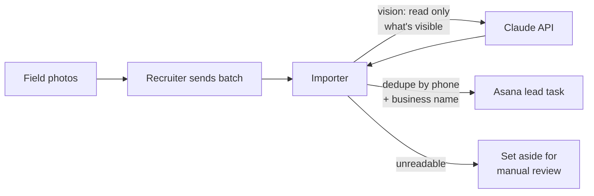

# AI Contractor Lead Intake

> Turns field photos of contractors' trucks, yard signs and business cards into ready-to-work recruiting leads in Asana, with duplicate checks, using Claude's vision API.

**Built for:** a facility services franchise that recruits independent contractors, where I'm the sole IT person
**When:** June – July 2026
**Stack:** Python · Claude API (vision) · Asana REST API · Pillow · C# / ASP.NET Core 8 + Microsoft Entra ID (web shell) · Docker · Render
**My role:** Designed, tested and deployed it. Built with Claude Code as an AI pair programmer.

> The code is internal company tooling and handles contractor contact details, so it stays private. This page describes what I built and how.

---

## The problem

Field staff photograph potential contractors (vehicle wraps, yard signs, business cards) and send the photos in. The recruiter was reading each photo and typing every lead into Asana by hand, about **50 leads a week**.

## How it works

For each photo it:

- Extracts only what's visible: business name, phone, email, website, services. It doesn't guess.
- Maps services to the **existing** Asana tags only; anything unmatched is noted rather than creating new tags.
- Checks for duplicates by phone number and business name before creating anything.
- Files the lead in the right project and section with progress set to "New".
- Sets aside unreadable photos instead of creating junk tasks.
- Has a dry-run mode, and never deletes anything in Asana.

## Two ways to run it

1. **Supervised, no added cost (in use):** a Claude Project with the Asana connector. A team member drops the week's photos into a chat and the tasks are created live.
2. **Automated (built, ready):** a standalone Python script on the Claude API, so a non-technical user can run it from their own machine. It goes live once usage-based API billing is approved.

## Web version (in progress)

An Entra-secured ASP.NET Core shell for the same job, deployed and linked from the company's internal portal: real sign-in, an app-role gate and a friendly access-denied page are live. While building it I fixed two real auth bugs (a role-claim mapping that made every role check fail, and an access-denied path silently overridden by the identity UI) and wrote them into a playbook for the other tools. Photo extraction in the web version is the next phase.

## Security and privacy

- API keys, tokens, real IDs, photos and logs are excluded from source control; only example config is tracked.
- The repository is private because it's internal tooling that touches contractor contact details.

---

*Part of a set of tools I built as the sole IT person at a facility services franchise. See my [profile](https://github.com/Matteoinfl) for the others.*
